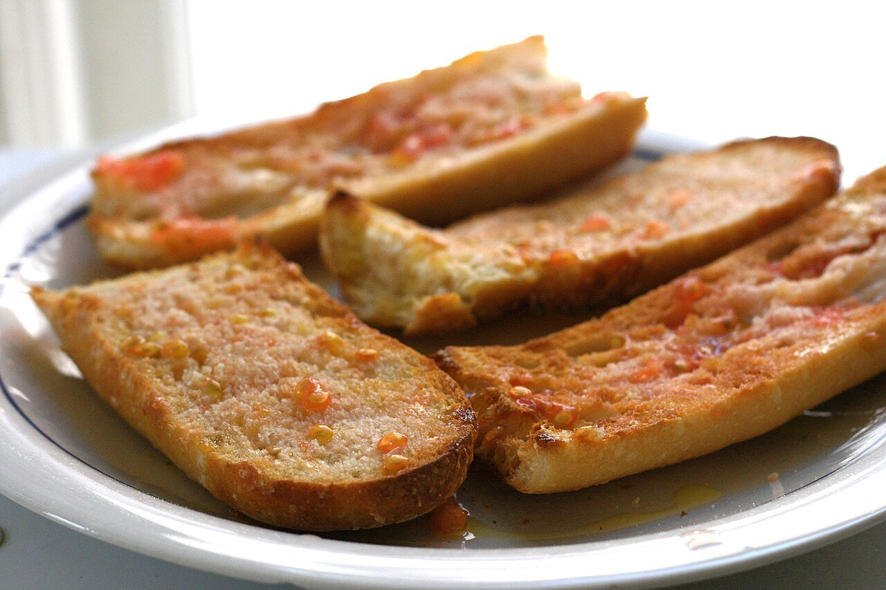

# Catalan tomato bread

*Photo: [Jennifer Woodard Maderazo](https://commons.wikimedia.org/wiki/File:Pa_amb_tomaquet.jpg), [CC BY 2.0](https://creativecommons.org/licenses/by/2.0/), via Wikimedia Commons.*

🍅 Serves **4** · ⏱️ 10 minutes · Difficulty: easy

*En español:* [Pan con tomate (pa amb tomàquet)](pan-con-tomate.es.md)

## Ingredients

- 4 large slices of rustic country bread (or 8 slices of ciabatta)
- 2 very ripe, juicy tomatoes
- 1 garlic clove (optional)
- Extra-virgin olive oil
- Salt

## Directions

1. **Toast.** Lightly toast the bread on a griddle or in a toaster; soft ciabatta can be left untoasted.
2. **Garlic (optional).** If you like, rub half a garlic clove over the warm bread.
3. **Rub the tomato.** Halve the tomatoes and rub the cut side firmly over the bread until it's bright red and only the skin is left.
4. **Season.** Add salt and a generous drizzle of oil. Serve right away.

## Tips

- **Hanging tomatoes:** the traditional Catalan variety is juicy and pulpy; use the ripest you can find.
- **Catalan order:** tomato, salt, then oil.
- **Serve with:** ham, cured sausages, cheese, Spanish omelette or anchovies. See also [toast with olive oil, tomato, garlic and serrano ham](../t/tostadas-de-aceite-tomate-ajo-jamon-serrano.en.md).
