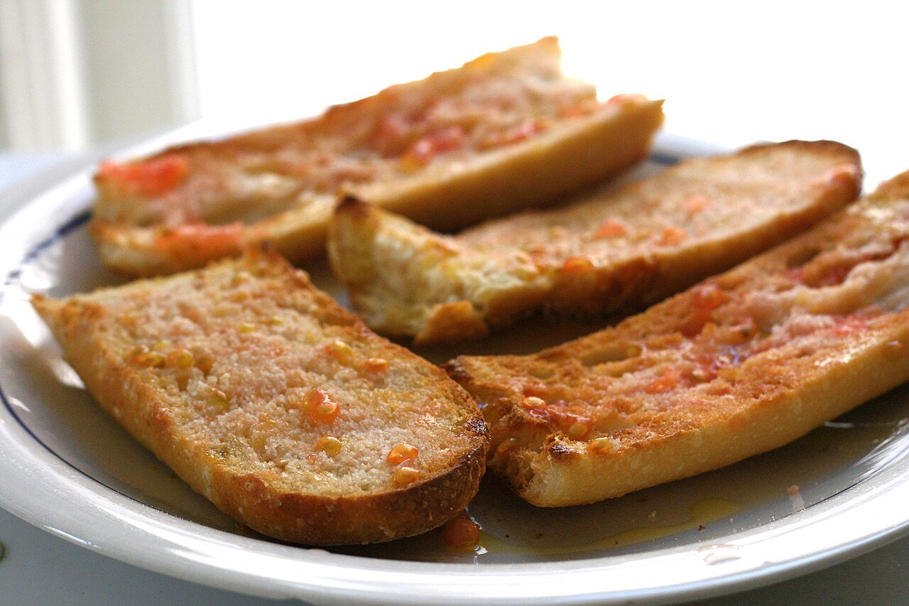

# Pan con tomate (pa amb tomàquet)

*Foto: [Jennifer Woodard Maderazo](https://commons.wikimedia.org/wiki/File:Pa_amb_tomaquet.jpg), [CC BY 2.0](https://creativecommons.org/licenses/by/2.0/deed.es), vía Wikimedia Commons.*

🍅 Para **4 personas** · ⏱️ 10 minutos · Dificultad: fácil

*In English:* [Catalan tomato bread](pan-con-tomate.en.md)

## Ingredientes

- 4 rebanadas grandes de pan de payés (o 8 de pan de coca)
- 2 tomates de colgar (o tomates muy maduros)
- 1 diente de ajo (opcional)
- Aceite de oliva virgen extra
- Sal

## Preparación

1. **Tostar.** Tuesta ligeramente el pan, en la plancha o la tostadora; si es pan de coca, puedes dejarlo sin tostar.
2. **Ajo (opcional).** Si te gusta, frota medio diente de ajo sobre el pan caliente.
3. **Restregar el tomate.** Parte los tomates por la mitad y restriégalos con fuerza sobre el pan, por el lado del corte, hasta que el pan quede bien rojo y solo quede la piel.
4. **Aliñar.** Añade sal y un buen chorro de aceite. Sirve enseguida.

## Consejos

- **Tomate de colgar:** es el tradicional en Cataluña, jugoso y con mucha pulpa.
- **Orden catalán:** tomate, sal y aceite, en ese orden.
- **Para acompañar:** jamón, embutidos, quesos, tortilla o anchoas. Mira también las [tostadas de aceite, tomate, ajo y jamón serrano](../t/tostadas-de-aceite-tomate-ajo-jamon-serrano.es.md).
