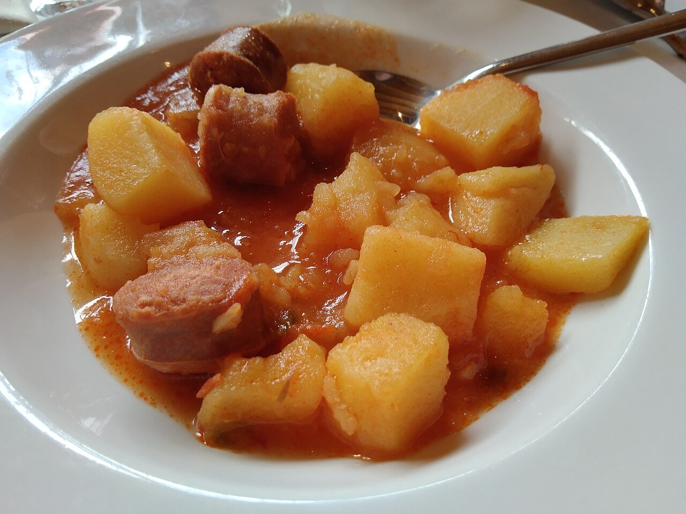

# Rioja-style potato and chorizo stew

*Photo: [Artistosteles](https://commons.wikimedia.org/wiki/File:Plato_de_patatas_a_la_riojana.jpg), [CC BY-SA 4.0](https://creativecommons.org/licenses/by-sa/4.0/), via Wikimedia Commons.*

🥔 Serves **4** · ⏱️ 50 minutes · Difficulty: easy

*En español:* [Patatas a la riojana](patatas-a-la-riojana.es.md)

## Ingredients

- 2¼ lb potatoes
- 2 Spanish cooking chorizos (about 9 oz)
- 1 onion
- 1 green bell pepper
- 2 garlic cloves
- 2 tablespoons choricero pepper paste (or 1 teaspoon sweet paprika)
- 1 dried chili (optional)
- 1 bay leaf
- 3 tablespoons olive oil
- Water and salt

## Directions

1. **Sofrito.** In a Dutch oven, cook the chopped onion, pepper and garlic in the oil for 10 minutes.
2. **Chorizo.** Add the thickly sliced chorizo and sauté 3 minutes to render its fat. Stir in the pepper paste (or the paprika, off the heat).
3. **Potatoes.** Peel the potatoes and break them into medium chunks. Add them and stir 2 minutes.
4. **Simmer.** Add water just to cover, the bay leaf, chili and salt. Simmer over medium heat 25–30 minutes, until the potatoes are tender.
5. **Rest.** Shake the pot to thicken the broth and let it rest 5 minutes before serving.

## Tips

- **Break, don't slice:** broken potatoes release starch that thickens the broth.
- **Choricero pepper:** a dried sweet pepper from Rioja and the Basque Country; it adds color and sweetness.
- **Serve with bread** to soak up the red broth.
