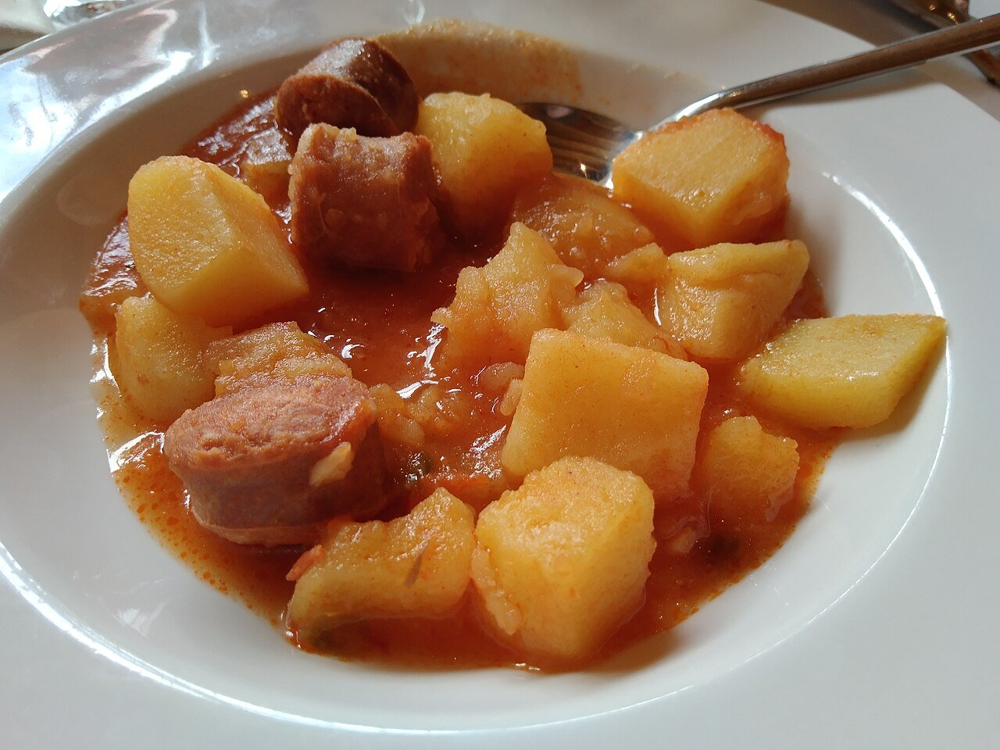

# Patatas a la riojana

*Foto: [Artistosteles](https://commons.wikimedia.org/wiki/File:Plato_de_patatas_a_la_riojana.jpg), [CC BY-SA 4.0](https://creativecommons.org/licenses/by-sa/4.0/deed.es), vía Wikimedia Commons.*

🥔 Para **4 personas** · ⏱️ 50 minutos · Dificultad: fácil

*In English:* [Rioja-style potato and chorizo stew](patatas-a-la-riojana.en.md)

## Ingredientes

- 1 kg de patatas
- 2 chorizos riojanos (unos 250 g)
- 1 cebolla
- 1 pimiento verde
- 2 dientes de ajo
- 2 cucharadas de carne de pimiento choricero (o 1 cucharadita de pimentón dulce)
- 1 guindilla (opcional)
- 1 hoja de laurel
- 3 cucharadas de aceite de oliva
- Agua y sal

## Preparación

1. **Sofrito.** En una cazuela, pocha la cebolla, el pimiento y el ajo picados en el aceite 10 minutos.
2. **El chorizo.** Añade el chorizo en rodajas gruesas y rehoga 3 minutos para que suelte la grasa. Añade la carne de choricero (o el pimentón, fuera del fuego).
3. **Las patatas.** Pela las patatas y cáscalas en trozos medianos. Añádelas a la cazuela y rehoga 2 minutos.
4. **Cocer.** Cubre justo con agua, añade el laurel, la guindilla y sal. Cuece a fuego medio 25–30 minutos, hasta que las patatas estén tiernas.
5. **Reposar.** Mueve la cazuela para que espese el caldo y deja reposar 5 minutos antes de servir.

## Consejos

- **Cascar, no cortar:** la patata cascada suelta almidón y engorda el caldo.
- **Choricero:** es el pimiento seco típico de La Rioja y el País Vasco; da color y dulzor.
- **Con pan:** imprescindible para mojar el caldo rojo.
