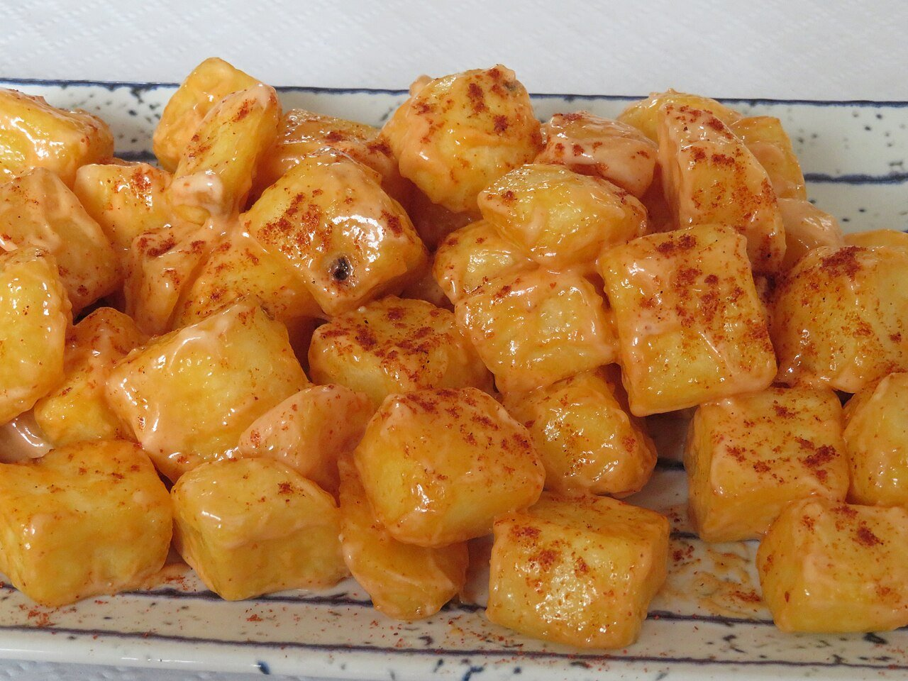

# Spicy fried potatoes

*Photo: [Juan Emilio Prades Bel](https://commons.wikimedia.org/wiki/File:Patatas_bravas._Tapa_de_bar_(Espa%C3%B1a).jpg), [CC BY 4.0](https://creativecommons.org/licenses/by/4.0/), via Wikimedia Commons.*

🌶️ Serves **4** · ⏱️ 45 minutes · Difficulty: easy

*En español:* [Patatas bravas](patatas-bravas.es.md)

## Ingredients

- 2¼ lb potatoes (russet or Yukon Gold)
- Olive or sunflower oil, for frying
- Salt

**For the brava sauce**

- 3 tablespoons olive oil
- 1 tablespoon all-purpose flour
- 1 tablespoon sweet smoked paprika
- 1–2 teaspoons hot smoked paprika (or ground cayenne)
- 1¼ cups chicken stock or water
- 1 splash sherry vinegar
- Salt

## Directions

1. **Cut.** Peel the potatoes and cut into rough 1¼-inch cubes. Rinse and pat very dry.
2. **First fry.** Fry in plenty of oil over medium heat (300 °F) for about 10 minutes, until tender but not browned. Remove.
3. **Sauce.** Heat the oil in a small saucepan, add the flour and stir 1 minute. Off the heat, add both paprikas. Slowly whisk in the stock and simmer 5 minutes until thick. Add the vinegar and salt, and blend if you want it smooth.
4. **Second fry.** Raise the oil to 375 °F and fry the potatoes again 3–4 minutes, until golden and crisp. Drain and salt.
5. **Serve.** Pile the potatoes on a plate and spoon the brava sauce over them. Add aioli too, if you like.

## Tips

- **Double frying:** tender inside, crisp outside.
- **Don't burn the paprika:** always add it off the heat.
- **"Mixed" bravas:** top with both brava sauce and aioli, as many Spanish bars do.
