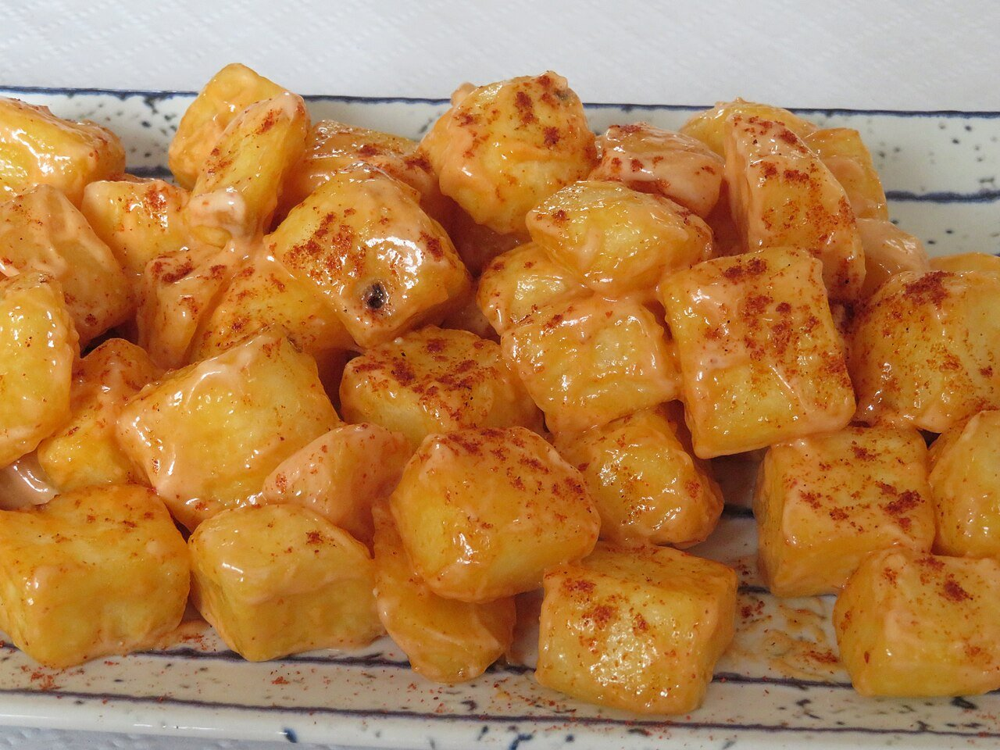

# Patatas bravas

*Foto: [Juan Emilio Prades Bel](https://commons.wikimedia.org/wiki/File:Patatas_bravas._Tapa_de_bar_(Espa%C3%B1a).jpg), [CC BY 4.0](https://creativecommons.org/licenses/by/4.0/deed.es), vía Wikimedia Commons.*

🌶️ Para **4 personas** · ⏱️ 45 minutos · Dificultad: fácil

*In English:* [Spicy fried potatoes](patatas-bravas.en.md)

## Ingredientes

- 1 kg de patatas
- Aceite de oliva o girasol, para freír
- Sal

**Para la salsa brava**

- 3 cucharadas de aceite de oliva
- 1 cucharada de harina
- 1 cucharada de pimentón dulce
- 1–2 cucharaditas de pimentón picante (o cayena molida)
- 300 ml de caldo de pollo o agua
- 1 chorrito de vinagre de Jerez
- Sal

## Preparación

1. **Cortar.** Pela las patatas y córtalas en dados irregulares de unos 3 cm. Lávalas y sécalas muy bien.
2. **Primera fritura.** Fríelas en abundante aceite a fuego medio (150 °C) unos 10 minutos, hasta que estén tiernas pero sin color. Sácalas.
3. **La salsa.** Calienta el aceite en un cazo, añade la harina y remueve 1 minuto. Fuera del fuego, echa los pimentones. Añade el caldo poco a poco, removiendo, y cuece 5 minutos hasta que espese. Añade el vinagre y sal, y tritura si quieres una salsa fina.
4. **Segunda fritura.** Sube el aceite a 190 °C y fríe de nuevo las patatas 3–4 minutos, hasta que estén doradas y crujientes. Escúrrelas y sálalas.
5. **Servir.** Pon las patatas en una fuente y cúbrelas con la salsa brava. Si quieres, añade también alioli.

## Consejos

- **Doble fritura:** tiernas por dentro y crujientes por fuera.
- **Pimentón sin quemar:** échalo siempre fuera del fuego.
- **Bravas mixtas:** con salsa brava y alioli por encima, como en muchos bares.
