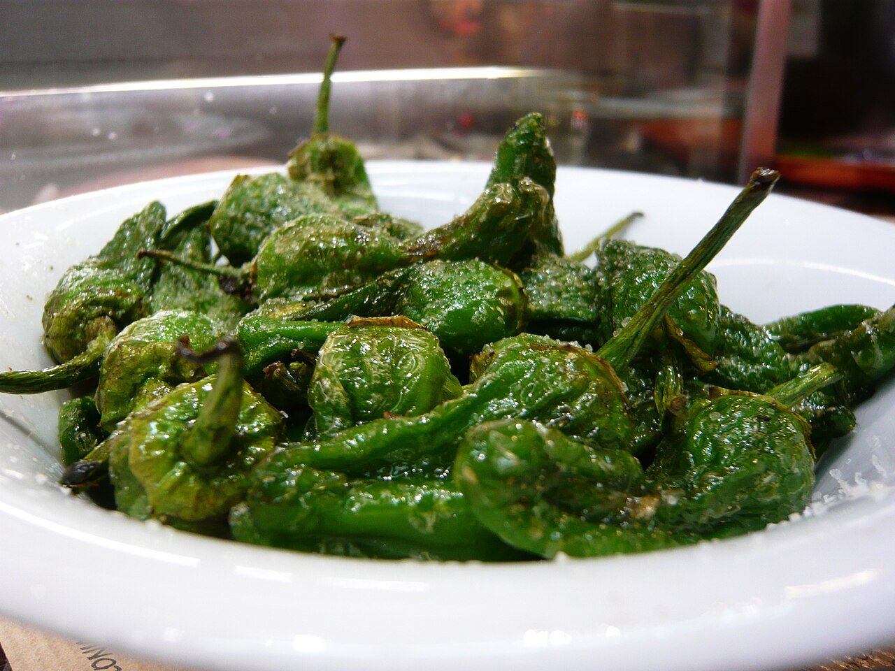

# Blistered Padrón peppers

*Photo: [Jessica Spengler](https://commons.wikimedia.org/wiki/File:Pimientos_de_Padr%C3%B3n_-_5.jpg), [CC BY 2.0](https://creativecommons.org/licenses/by/2.0/), via Wikimedia Commons.*

🫑 Serves **4** · ⏱️ 10 minutes · Difficulty: easy

*En español:* [Pimientos de Padrón](pimientos-de-padron.es.md)

## Ingredients

- 14 oz Padrón peppers (or shishito peppers)
- 4 tablespoons extra-virgin olive oil
- Coarse or flaky salt

## Directions

1. **Rinse and dry.** Rinse the peppers and dry them very well; water makes the oil spatter. Leave the stems on.
2. **Fry.** Heat the oil in a wide skillet over high heat. Add the peppers and toss, shaking the pan, for 3–4 minutes, until blistered and browned in spots.
3. **Drain.** Transfer briefly to a plate lined with paper towels.
4. **Salt.** Move to a serving dish and sprinkle generously with coarse salt. Serve right away.

## Tips

- **"Some are hot, some are not":** most are mild, but the odd one is spicy; that's part of the fun.
- **Season:** May to October, when they're small and tender.
- **Pair with** Galician octopus, broken eggs or a cold beer.
