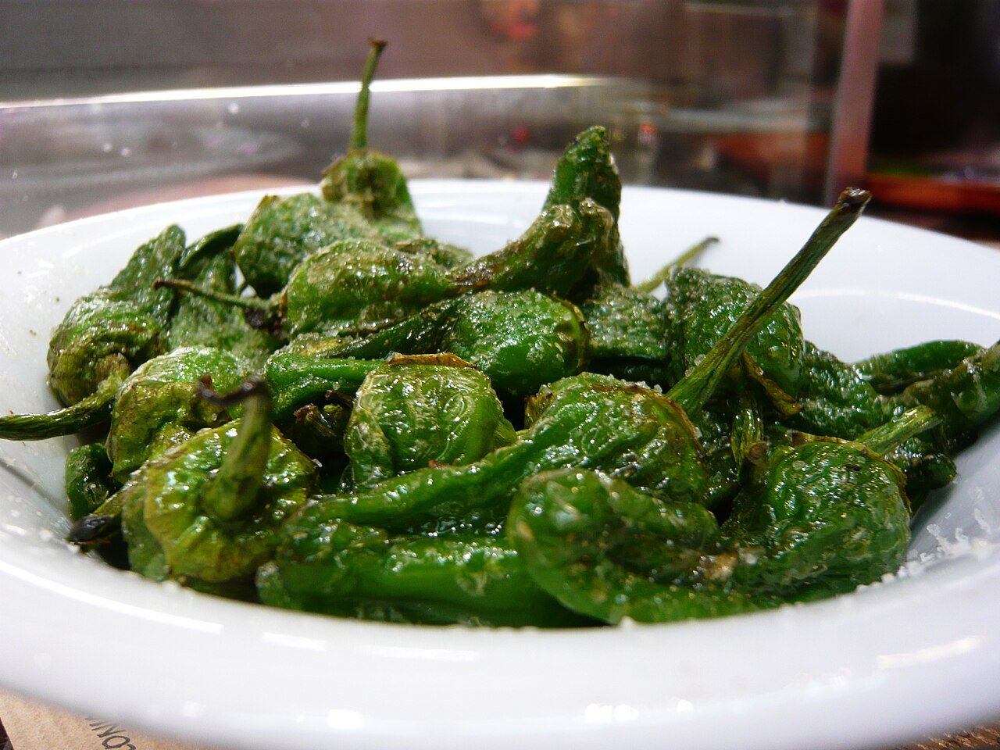

# Pimientos de Padrón

*Foto: [Jessica Spengler](https://commons.wikimedia.org/wiki/File:Pimientos_de_Padr%C3%B3n_-_5.jpg), [CC BY 2.0](https://creativecommons.org/licenses/by/2.0/deed.es), vía Wikimedia Commons.*

🫑 Para **4 personas** · ⏱️ 10 minutos · Dificultad: fácil

*In English:* [Blistered Padrón peppers](pimientos-de-padron.en.md)

## Ingredientes

- 400 g de pimientos de Padrón
- 4 cucharadas de aceite de oliva virgen extra
- Sal gorda o en escamas

## Preparación

1. **Lavar y secar.** Lava los pimientos y sécalos muy bien; el agua hace saltar el aceite. No les quites el rabo.
2. **Freír.** Calienta el aceite en una sartén amplia a fuego fuerte. Añade los pimientos y saltéalos, moviendo la sartén, 3–4 minutos, hasta que la piel se ampolle y se dore en algunas zonas.
3. **Escurrir.** Sácalos a un plato con papel de cocina un momento.
4. **Salar.** Pásalos a una fuente y espolvorea con sal gruesa por encima. Sirve enseguida.

## Consejos

- **"Unos pican e outros non":** la mayoría son suaves, pero alguno sale picante; es parte de la gracia.
- **Temporada:** de mayo a octubre, cuando son pequeños y tiernos.
- **Con tapa:** perfectos junto a pulpo, huevos rotos o una cerveza fría.
