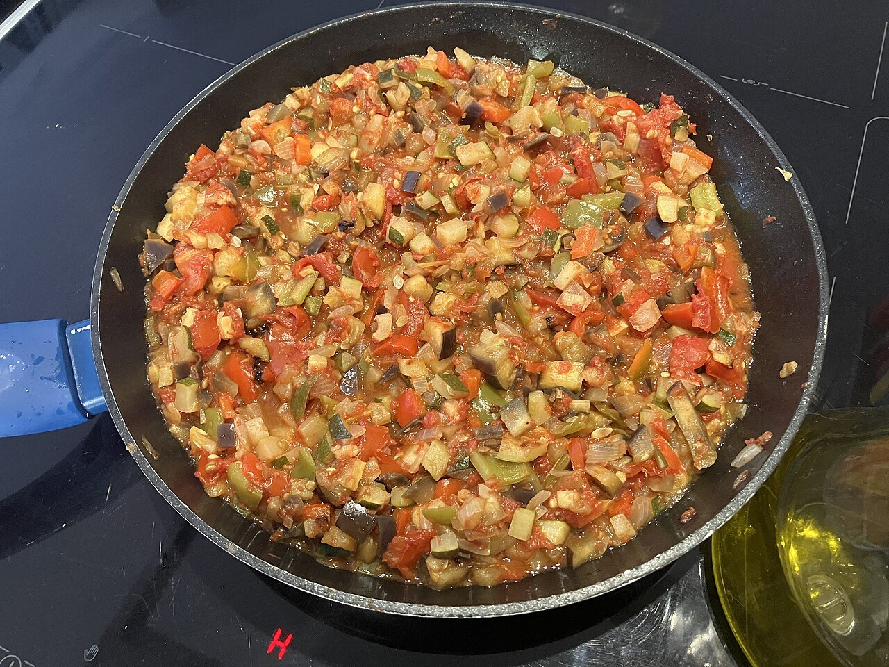

# La Mancha vegetable stew

*Photo: [El Mono Español](https://commons.wikimedia.org/wiki/File:Pisto_manchego.jpg), [CC BY-SA 4.0](https://creativecommons.org/licenses/by-sa/4.0/), via Wikimedia Commons.*

🍅 Serves **4** · ⏱️ 1 hour · Difficulty: easy

*En español:* [Pisto manchego](pisto-manchego.es.md)

## Ingredients

- 2 onions
- 1 green bell pepper
- 1 red bell pepper
- 2 zucchini
- 2¼ lb ripe tomatoes (or one 28-oz can crushed tomatoes)
- 2 garlic cloves
- 1 teaspoon sugar (if the tomatoes are acidic)
- 6 tablespoons extra-virgin olive oil
- Salt
- 4 eggs, to serve (optional)

## Directions

1. **Dice.** Cut the onion, peppers and zucchini into small, even cubes. Peel and chop the tomatoes.
2. **Onion and peppers.** In a deep skillet, gently cook the onion and garlic in the oil for 10 minutes. Add the peppers and cook 10 minutes more.
3. **Zucchini.** Add the zucchini with a little salt and cook 10 minutes.
4. **Tomato.** Add the tomatoes, plus the sugar if needed, and simmer gently 20–25 minutes, stirring now and then, until the liquid evaporates.
5. **Serve.** Adjust the salt. Serve hot topped with a fried egg, or warm with bread.

## Tips

- **One vegetable at a time:** each keeps its own texture.
- **Take it slow:** pisto improves with gentle cooking.
- **Keeps** 4 days in the fridge and freezes well; use it as a filling for pies or a base for rice.
