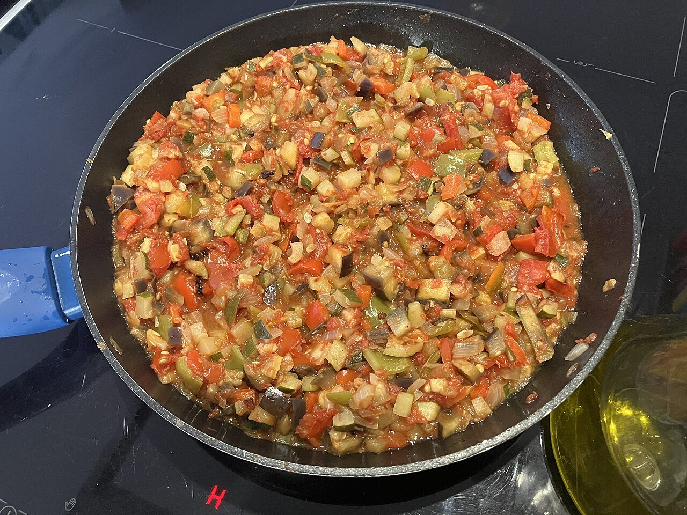

# Pisto manchego

*Foto: [El Mono Español](https://commons.wikimedia.org/wiki/File:Pisto_manchego.jpg), [CC BY-SA 4.0](https://creativecommons.org/licenses/by-sa/4.0/deed.es), vía Wikimedia Commons.*

🍅 Para **4 personas** · ⏱️ 1 hora · Dificultad: fácil

*In English:* [La Mancha vegetable stew](pisto-manchego.en.md)

## Ingredientes

- 2 cebollas
- 1 pimiento verde
- 1 pimiento rojo
- 2 calabacines
- 1 kg de tomates maduros (o 800 g de tomate triturado)
- 2 dientes de ajo
- 1 cucharadita de azúcar (si el tomate está ácido)
- 6 cucharadas de aceite de oliva virgen extra
- Sal
- 4 huevos, para servir (opcional)

## Preparación

1. **Picar.** Corta la cebolla, los pimientos y el calabacín en dados pequeños, todos del mismo tamaño. Pela y trocea los tomates.
2. **Cebolla y pimientos.** En una sartén honda, pocha la cebolla y el ajo en el aceite a fuego suave 10 minutos. Añade los pimientos y cocina 10 minutos más.
3. **Calabacín.** Añade el calabacín con un poco de sal y sigue 10 minutos.
4. **Tomate.** Añade el tomate, el azúcar si hace falta, y cuece a fuego suave 20–25 minutos, removiendo de vez en cuando, hasta que se evapore el agua.
5. **Servir.** Ajusta de sal. Sírvelo caliente con un huevo frito encima, o templado con pan.

## Consejos

- **Cada verdura a su tiempo:** así cada una conserva su textura.
- **Sin prisa:** el pisto mejora con la cocción lenta.
- **Se conserva** 4 días en la nevera y se congela bien; sirve de base para empanadas o arroces.
