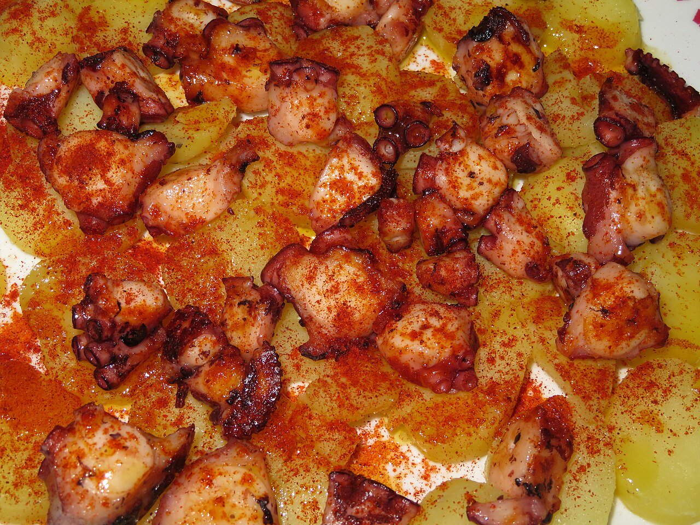

# Galician-style octopus

*Photo: [Juan Emilio Prades Bel](https://commons.wikimedia.org/wiki/File:Pulpo_a_la_gallega_con_cachelos.jpg), [CC BY 4.0](https://creativecommons.org/licenses/by/4.0/), via Wikimedia Commons.*

🐙 Serves **4** · ⏱️ 1 hour 15 minutes · Difficulty: medium

*En español:* [Pulpo a la gallega](pulpo-a-la-gallega.es.md)

## Ingredients

- 1 octopus, about 4½ lb (previously frozen)
- 4 medium potatoes (optional)
- Sweet and hot smoked paprika (pimentón de la Vera)
- Coarse salt
- Extra-virgin olive oil
- 1 onion (optional, for the water)

## Directions

1. **Thaw.** If fresh, freeze it for at least 2 days: this tenderizes it. Thaw in the fridge for 24 hours.
2. **Dip.** Bring a large pot of water (with the onion) to a boil. Hold the octopus by the head and dip it in and out of the water three times so the tentacles curl.
3. **Boil.** Leave it in and simmer over medium heat about 40–45 minutes (about 10 minutes per pound). Pierce the thick part of a tentacle: it should go in easily. Rest 10 minutes in the water.
4. **Potatoes.** Boil the peeled potatoes in the octopus water about 20 minutes and cut into thick slices.
5. **Serve.** Snip the tentacles into rounds with scissors onto a wooden plate (or over the potatoes). Sprinkle with coarse salt, paprika and a generous drizzle of oil.

## Tips

- **Freeze it first:** freezing tenderizes octopus as well as the old method of beating it.
- **Don't salt the water:** octopus is naturally salty; salt goes on at the end.
- **Wooden plate:** the traditional way in Galician octopus houses; it soaks up excess water.
