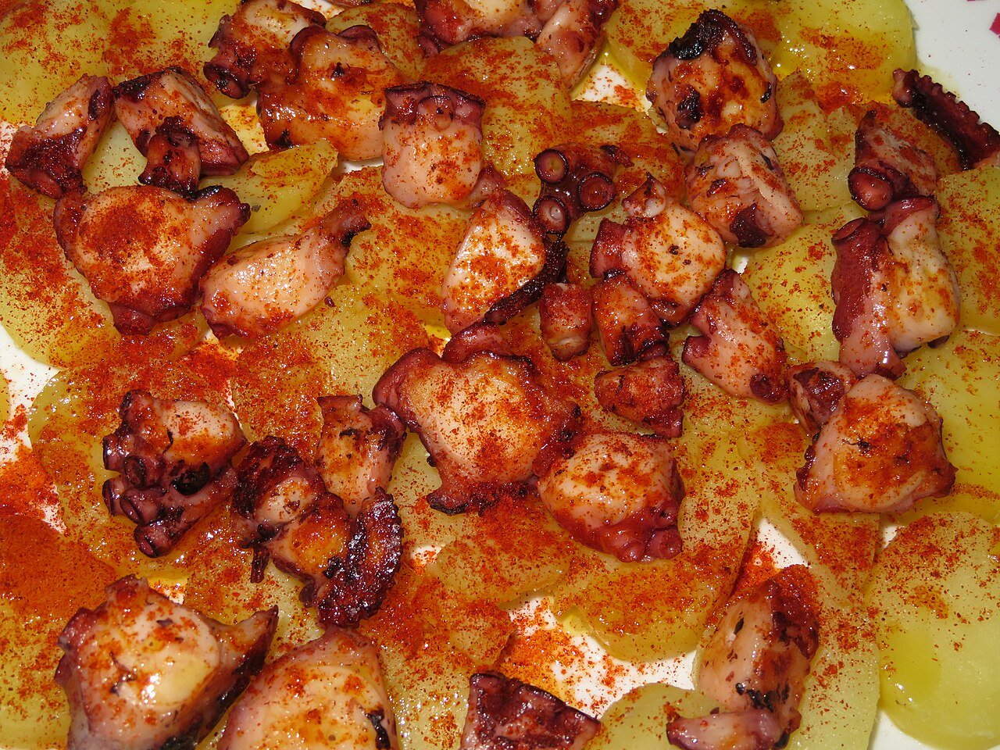

# Pulpo a la gallega

*Foto: [Juan Emilio Prades Bel](https://commons.wikimedia.org/wiki/File:Pulpo_a_la_gallega_con_cachelos.jpg), [CC BY 4.0](https://creativecommons.org/licenses/by/4.0/deed.es), vía Wikimedia Commons.*

🐙 Para **4 personas** · ⏱️ 1 hora 15 minutos · Dificultad: media

*In English:* [Galician-style octopus](pulpo-a-la-gallega.en.md)

## Ingredientes

- 1 pulpo de unos 2 kg (congelado previamente)
- 4 patatas medianas (opcional, para cachelos)
- Pimentón dulce y picante de la Vera
- Sal gorda
- Aceite de oliva virgen extra
- 1 cebolla (opcional, para el agua)

## Preparación

1. **Descongelar.** Si es fresco, congélalo al menos 2 días: así se ablanda. Descongélalo en la nevera 24 horas.
2. **Asustar.** Lleva a ebullición una olla grande con agua (y la cebolla). Coge el pulpo por la cabeza y mételo y sácalo del agua tres veces, para que se ricen los tentáculos.
3. **Cocer.** Déjalo dentro y cuece a fuego medio unos 40–45 minutos (20 minutos por kilo). Pincha la parte gruesa del tentáculo: debe entrar sin resistencia. Deja reposar 10 minutos en el agua.
4. **Cachelos.** Cuece las patatas peladas en el agua del pulpo unos 20 minutos y córtalas en rodajas gruesas.
5. **Servir.** Corta los tentáculos en rodajas con tijeras sobre un plato de madera (o sobre los cachelos). Espolvorea sal gorda, pimentón y un buen chorro de aceite.

## Consejos

- **Congelar antes:** ablanda el pulpo tanto como el método tradicional de golpearlo.
- **No sales el agua:** el pulpo ya es salado; la sal va al final.
- **Plato de madera:** el tradicional de las pulperías, absorbe el exceso de agua.
