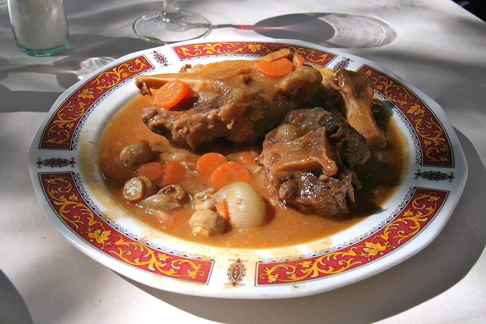

# Braised oxtail in red wine

*Photo: [Tamorlan](https://commons.wikimedia.org/wiki/File:Rabo_de_toro-Estofado_(01).JPG), [CC BY-SA 3.0](https://creativecommons.org/licenses/by-sa/3.0/), via Wikimedia Commons.*

🍷 Serves **4** · ⏱️ 4 hours · Difficulty: medium

*En español:* [Rabo de toro](rabo-de-toro.es.md)

## Ingredients

- 3¼ lb oxtail, cut at the joints
- 2 onions
- 2 carrots
- 1 leek
- 1 red bell pepper
- 3 garlic cloves
- 1 ripe tomato
- 1 bottle (750 ml) dry red wine
- 2 cups beef stock
- 2 bay leaves and 1 sprig thyme
- All-purpose flour, for dredging
- 5 tablespoons olive oil
- Salt and pepper

## Directions

1. **Brown the oxtail.** Season the pieces, dredge in flour and brown well in a Dutch oven with the oil. Set aside.
2. **Vegetables.** In the same oil, gently cook the chopped vegetables and garlic for about 15 minutes. Add the tomato and cook 5 minutes more.
3. **Wine.** Return the oxtail, pour in the wine and boil 5 minutes to cook off the alcohol. Add the stock, bay leaves and thyme.
4. **Braise.** Cover and simmer over very low heat 3–3½ hours (or 1 hour in a pressure cooker), until the meat falls off the bone.
5. **Sauce.** Remove the oxtail, discard the herbs and blend the sauce. Reduce it if thin. Return the meat and heat through 5 minutes.

## Tips

- **Better the next day:** the fat also solidifies when chilled and is easy to remove.
- **Good wine:** if you wouldn't drink it, don't cook with it.
- **Serve with** fries, mashed potatoes or white rice.
