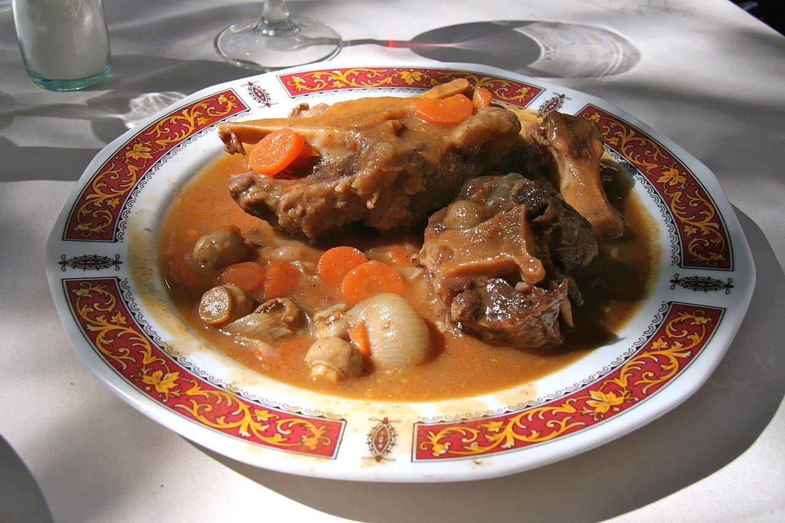

# Rabo de toro

*Foto: [Tamorlan](https://commons.wikimedia.org/wiki/File:Rabo_de_toro-Estofado_(01).JPG), [CC BY-SA 3.0](https://creativecommons.org/licenses/by-sa/3.0/deed.es), vía Wikimedia Commons.*

🍷 Para **4 personas** · ⏱️ 4 horas · Dificultad: media

*In English:* [Braised oxtail in red wine](rabo-de-toro.en.md)

## Ingredientes

- 1,5 kg de rabo de toro o de ternera, troceado por las juntas
- 2 cebollas
- 2 zanahorias
- 1 puerro
- 1 pimiento rojo
- 3 dientes de ajo
- 1 tomate maduro
- 750 ml de vino tinto
- 500 ml de caldo de carne
- 2 hojas de laurel y 1 ramita de tomillo
- Harina, para enharinar
- 5 cucharadas de aceite de oliva
- Sal y pimienta

## Preparación

1. **Dorar el rabo.** Salpimienta los trozos, pásalos por harina y dóralos bien en una cazuela con el aceite. Resérvalos.
2. **Verduras.** En el mismo aceite, pocha a fuego suave las verduras troceadas y el ajo unos 15 minutos. Añade el tomate y cocina 5 minutos más.
3. **El vino.** Devuelve el rabo, vierte el vino y deja que hierva 5 minutos para que se evapore el alcohol. Añade el caldo, el laurel y el tomillo.
4. **Guisar.** Tapa y cuece a fuego muy suave 3–3½ horas (o 1 hora en olla rápida), hasta que la carne se separe sola del hueso.
5. **La salsa.** Saca el rabo, retira las hierbas y tritura la salsa. Redúcela si está líquida. Devuelve la carne y calienta 5 minutos.

## Consejos

- **Mejor al día siguiente:** además, la grasa solidifica en frío y es fácil de quitar.
- **El vino, bueno:** si no te lo beberías, no lo uses en el guiso.
- **Para acompañar:** patatas fritas, puré o arroz blanco.
