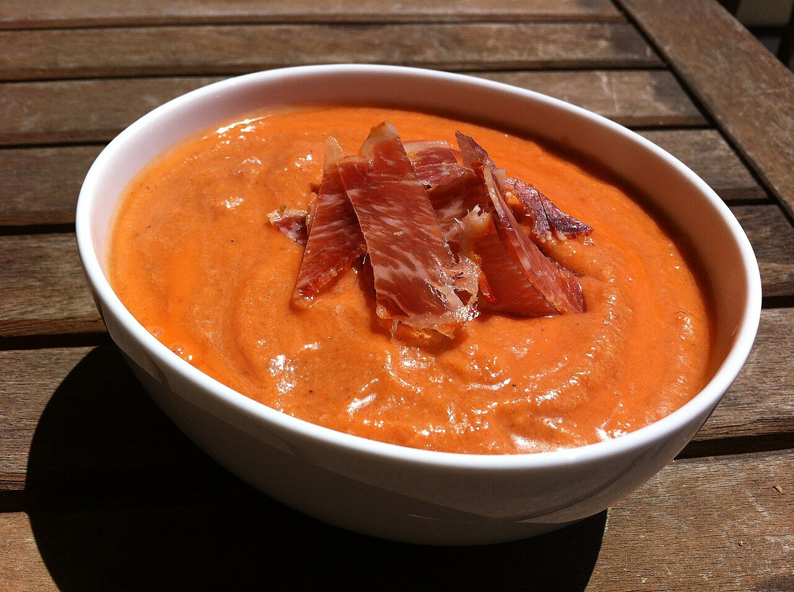

# Salmorejo cordobés

*Foto: [P.Lechien](https://commons.wikimedia.org/wiki/File:Salmorejo_cordouan.JPG), [CC0](https://creativecommons.org/publicdomain/zero/1.0/deed.es), vía Wikimedia Commons.*

🍅 Para **4 personas** · ⏱️ 15 minutos + 1 hora de frío · Dificultad: fácil

*In English:* [Córdoba-style cold tomato cream](salmorejo-cordobes.en.md)

## Ingredientes

- 1 kg de tomates muy maduros (de pera)
- 200 g de pan de telera o pan de miga densa del día anterior
- 1 diente de ajo pequeño
- 150 ml de aceite de oliva virgen extra
- 1 cucharadita de sal
- 1 cucharada de vinagre de Jerez (opcional)

**Para servir:** 2 huevos cocidos picados, 80 g de jamón serrano en taquitos y aceite.

## Preparación

1. **Triturar el tomate.** Lava y trocea los tomates. Tritúralos bien y pásalos por un colador para quitar pieles y semillas.
2. **El pan.** Trocea el pan sin corteza y déjalo empapar en el tomate triturado 10 minutos.
3. **Emulsionar.** Añade el ajo y la sal y tritura. Con la batidora en marcha, vierte el aceite en hilo hasta obtener una crema espesa y anaranjada. Añade el vinagre si lo usas.
4. **Enfriar.** Ajusta de sal y refrigéralo al menos 1 hora.
5. **Servir.** Reparte en cuencos y decora con el huevo picado, el jamón y un hilo de aceite.

## Consejos

- **Más espeso que el gazpacho:** debe quedar como una crema que se sostiene en la cuchara.
- **Vegetariano:** sin jamón, con dados de aguacate o atún.
- **Se conserva** 2–3 días en la nevera.
