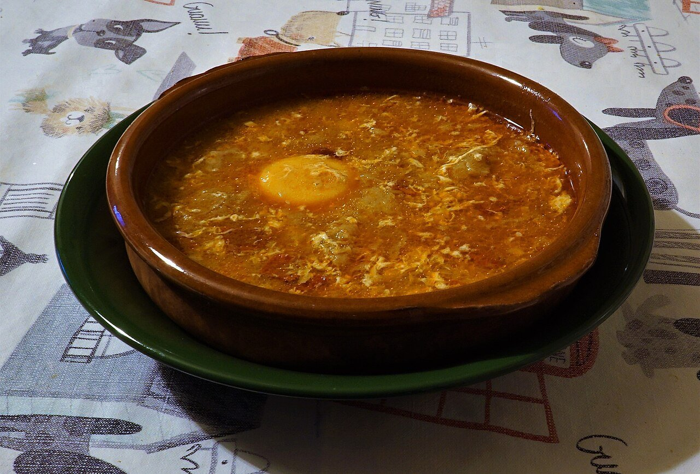

# Castilian garlic soup

*Photo: [Coralma*](https://commons.wikimedia.org/wiki/File:Sopa_de_Ajo.jpg), [CC0](https://creativecommons.org/publicdomain/zero/1.0/), via Wikimedia Commons.*

🧄 Serves **4** · ⏱️ 30 minutes · Difficulty: easy

*En español:* [Sopa de ajo castellana](sopa-de-ajo-castellana.es.md)

## Ingredients

- 6 garlic cloves, sliced
- 7 oz stale rustic bread, thinly sliced
- 3½ oz diced serrano ham (optional)
- 1 tablespoon sweet smoked paprika (pimentón de la Vera)
- 5 cups chicken stock or water
- 4 eggs
- 5 tablespoons olive oil
- Salt

## Directions

1. **Brown the garlic.** In an earthenware pot or saucepan, heat the oil over low heat and gently brown the garlic without burning it. Add the ham and sauté 1 minute.
2. **Bread.** Add the bread and stir 2–3 minutes so it soaks up the oil and toasts slightly.
3. **Paprika and stock.** Take off the heat, stir in the paprika and immediately pour in the hot stock.
4. **Simmer.** Simmer gently 15 minutes, until the bread starts to break down. Taste for salt.
5. **Eggs.** Crack the eggs over the soup and let them set 3–4 minutes, or beat them and drizzle in while stirring. Serve piping hot.

## Tips

- **Good bread:** stale rustic bread holds up without fully dissolving.
- **Oven-baked:** in individual earthenware bowls with an egg on top, 5 minutes at 400 °F.
- **A winter soup:** traditional in Castile during Lent and on cold days.
