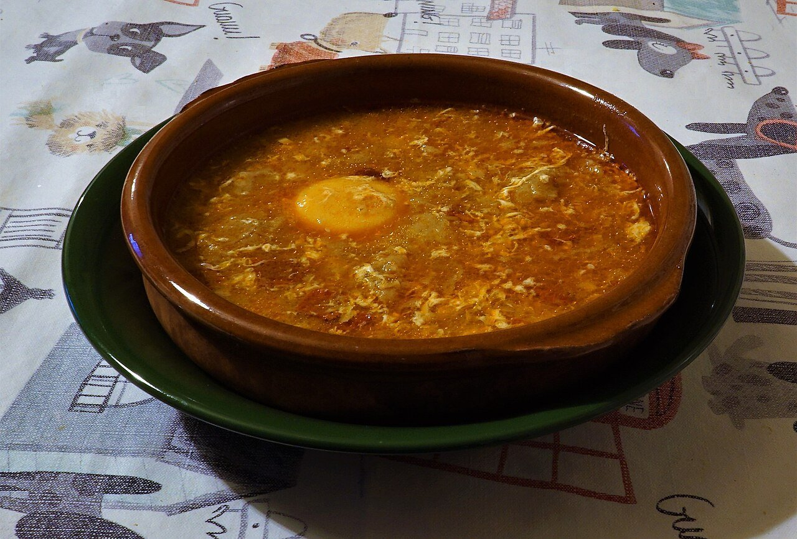

# Sopa de ajo castellana

*Foto: [Coralma*](https://commons.wikimedia.org/wiki/File:Sopa_de_Ajo.jpg), [CC0](https://creativecommons.org/publicdomain/zero/1.0/deed.es), vía Wikimedia Commons.*

🧄 Para **4 personas** · ⏱️ 30 minutos · Dificultad: fácil

*In English:* [Castilian garlic soup](sopa-de-ajo-castellana.en.md)

## Ingredientes

- 6 dientes de ajo en láminas
- 200 g de pan duro de pueblo en rebanadas finas
- 100 g de jamón serrano en taquitos (opcional)
- 1 cucharada de pimentón dulce de la Vera
- 1,25 litros de caldo de pollo o agua
- 4 huevos
- 5 cucharadas de aceite de oliva
- Sal

## Preparación

1. **Dorar el ajo.** En una cazuela de barro o una olla, calienta el aceite a fuego suave y dora el ajo sin que se queme. Añade el jamón y rehoga 1 minuto.
2. **El pan.** Añade el pan y remueve 2–3 minutos para que se impregne de aceite y se tueste un poco.
3. **Pimentón y caldo.** Retira del fuego, añade el pimentón, remueve y vierte el caldo caliente enseguida.
4. **Cocer.** Cuece a fuego suave 15 minutos, hasta que el pan se deshaga un poco. Prueba de sal.
5. **Los huevos.** Casca los huevos sobre la sopa y deja que cuajen 3–4 minutos, o bátelos y añádelos en hilo removiendo. Sirve muy caliente.

## Consejos

- **Pan bueno:** el de pueblo, duro, aguanta sin deshacerse del todo.
- **Al horno:** en cazuelitas de barro individuales, con el huevo encima, 5 minutos a 200 °C.
- **Sopa de invierno:** tradicional en Castilla en Cuaresma y en días de frío.
