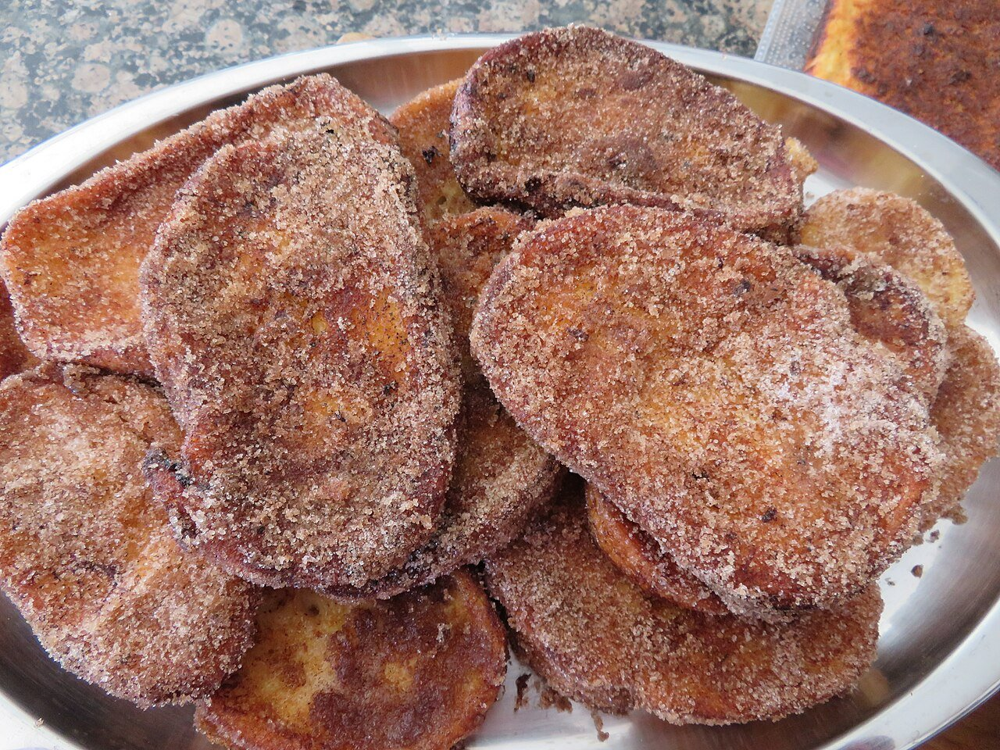

# Spanish milk-soaked fried bread

*Photo: [Juan Emilio Prades Bel](https://commons.wikimedia.org/wiki/File:Torrijas,_gastronom%C3%ADa_de_Semana_Santa_(Espa%C3%B1a).jpg), [CC BY 4.0](https://creativecommons.org/licenses/by/4.0/), via Wikimedia Commons.*

🍞 Makes **about 12** · ⏱️ 45 minutes · Difficulty: easy

*En español:* [Torrijas](torrijas.es.md)

## Ingredients

- 1 loaf dense day-old bread (or brioche), cut into ¾-inch slices
- 4 cups whole milk
- ¾ cup sugar, plus more for coating
- 1 cinnamon stick
- Peel of 1 lemon and ½ orange
- 3 eggs, beaten
- Mild olive or sunflower oil, for frying
- Ground cinnamon, for coating

## Directions

1. **Infuse.** Heat the milk with the sugar, cinnamon stick and peels. When it boils, turn off the heat and let it cool 15 minutes. Strain.
2. **Soak.** Lay the slices in a dish and pour the warm milk over them. Let them soak a few minutes, turning once, without breaking.
3. **Dip in egg.** Lift them out carefully, let them drip and dip in the beaten egg.
4. **Fry.** Fry in hot oil (340 °F) 1–2 minutes per side, until golden. Drain on paper towels.
5. **Coat.** Mix sugar with ground cinnamon and coat the warm torrijas.

## Tips

- **Right bread:** dense crumb; soft bread falls apart when soaked.
- **Other versions:** soak in syrup, honey or sweet wine instead of milk.
- **An Easter treat:** the traditional Lent dessert all over Spain.
