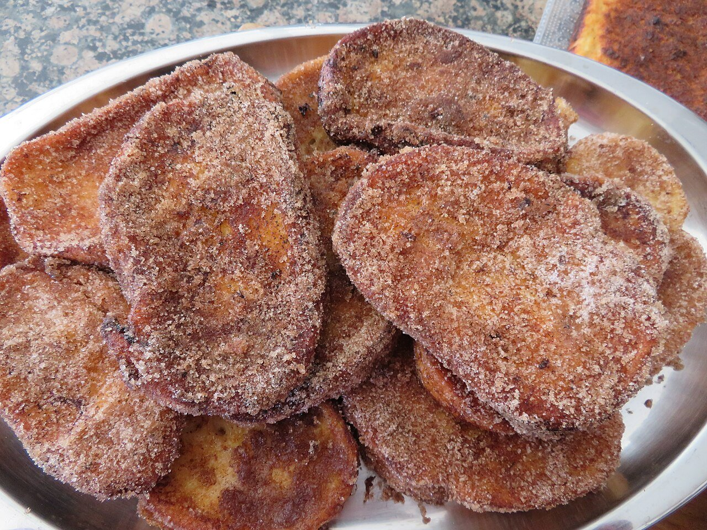

# Torrijas

*Foto: [Juan Emilio Prades Bel](https://commons.wikimedia.org/wiki/File:Torrijas,_gastronom%C3%ADa_de_Semana_Santa_(Espa%C3%B1a).jpg), [CC BY 4.0](https://creativecommons.org/licenses/by/4.0/deed.es), vía Wikimedia Commons.*

🍞 Para **unas 12 torrijas** · ⏱️ 45 minutos · Dificultad: fácil

*In English:* [Spanish milk-soaked fried bread](torrijas.en.md)

## Ingredientes

- 1 barra de pan especial para torrijas (o pan del día anterior), en rebanadas de 2 cm
- 1 litro de leche entera
- 150 g de azúcar, y más para rebozar
- 1 rama de canela
- La piel de 1 limón y de ½ naranja
- 3 huevos batidos
- Aceite de oliva suave o de girasol, para freír
- Canela molida, para rebozar

## Preparación

1. **Infusionar.** Calienta la leche con el azúcar, la canela y las pieles. Cuando hierva, apaga el fuego y deja templar 15 minutos. Cuela.
2. **Empapar.** Coloca las rebanadas en una fuente y báñalas con la leche templada. Deja que se empapen unos minutos, dándoles la vuelta, sin que se rompan.
3. **Pasar por huevo.** Escúrrelas con cuidado y pásalas por el huevo batido.
4. **Freír.** Fríelas en aceite caliente (170 °C) 1–2 minutos por lado, hasta que estén doradas. Escúrrelas sobre papel de cocina.
5. **Rebozar.** Mezcla azúcar con canela molida y reboza las torrijas aún calientes.

## Consejos

- **Pan adecuado:** de miga prieta; si es blando, se deshace al empaparlo.
- **Otras versiones:** con almíbar, miel o vino dulce en lugar de leche.
- **Dulce de Semana Santa:** es el postre tradicional de la Cuaresma en toda España.
