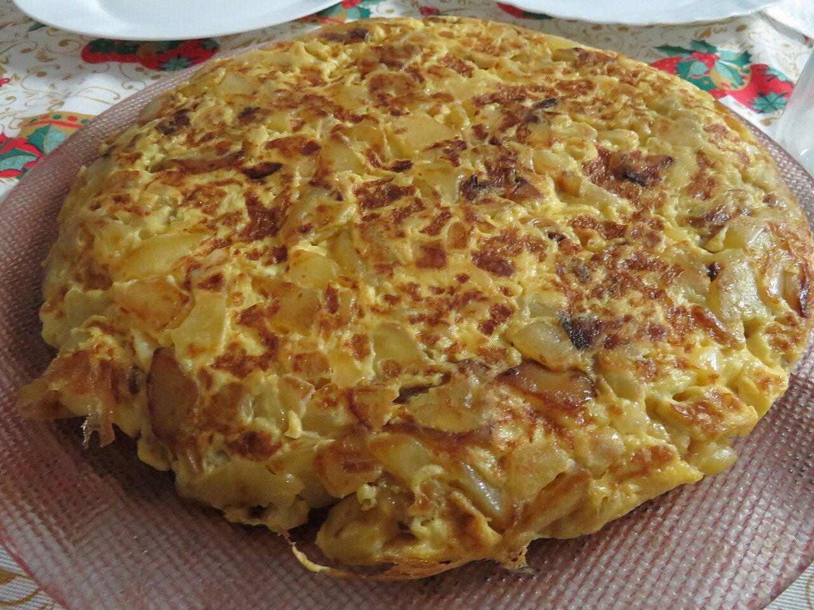

# Spanish potato omelette with onion

*Photo: [Juan Emilio Prades Bel](https://commons.wikimedia.org/wiki/File:Tortilla_espa%C3%B1ola_con_patatas_y_cebolla.jpg), [CC BY 4.0](https://creativecommons.org/licenses/by/4.0/), via Wikimedia Commons.*

🥔 Serves **4** · ⏱️ 50 minutes · Difficulty: medium

*En español:* [Tortilla de patata con cebolla](tortilla-de-patata-con-cebolla.es.md)

## Ingredients

- 6 large eggs
- 1⅔ lb potatoes (about 4 medium; Yukon Gold works well)
- 1 large yellow onion (about 9 oz)
- 1¼–1⅔ cups extra-virgin olive oil, for slow-frying
- Salt

## Directions

1. **Slice.** Peel, rinse, and dry the potatoes. Cut them into thin slices, about ⅛ inch thick, or into uneven chunks for a more rustic omelette. Peel the onion and slice it thinly.
2. **Slow-fry.** Heat the oil in a skillet over medium heat; it shouldn't smoke. Add the potatoes and onion with a pinch of salt. Cook them gently for 20–25 minutes, stirring now and then, until tender and lightly golden, not crispy.
3. **Drain.** Transfer them to a strainer set over a bowl and let the oil drain off. Save that oil for your next omelette or for cooking.
4. **Beat and rest.** Beat the eggs with salt in a large bowl. Stir in the still-warm potatoes and onion and let the mixture rest for **10 minutes**: the potatoes soak up the egg and the omelette turns out juicier.
5. **Set.** Heat 1 tablespoon of the saved oil in a 9- to 10-inch nonstick skillet over medium-high heat. Pour in the mixture, spread it out, and lower the heat. Loosen the edges with a spatula and let it set for 3–4 minutes.
6. **Flip.** Place a flat plate larger than the skillet on top and turn it over in one quick move. Slide the omelette back into the skillet, uncooked side down, and tuck in the edges.
7. **Finish.** Cook 1–2 more minutes for a runny center, or 3–4 if you like it fully set. Serve warm or at room temperature.

## Tips

- **Juicy inside:** keep the heat low while slow-frying, and keep the final cooking short.
- **Flip with confidence:** before flipping, the omelette should slide freely when you shake the skillet; if it sticks, loosen the edges and bottom with the spatula.
- **Caramelized onion:** for a sweeter omelette, start the onion a few minutes before the potatoes.
- **Keeps** for 2 days in the fridge, covered. Let it sit out for a while before eating.
