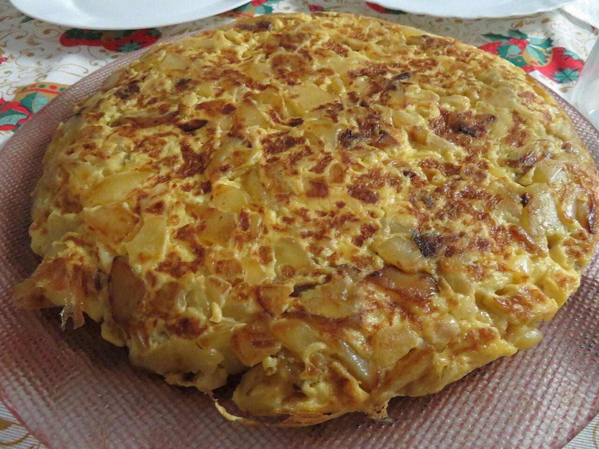

# Tortilla de patata con cebolla

*Foto: [Juan Emilio Prades Bel](https://commons.wikimedia.org/wiki/File:Tortilla_espa%C3%B1ola_con_patatas_y_cebolla.jpg), [CC BY 4.0](https://creativecommons.org/licenses/by/4.0/deed.es), vía Wikimedia Commons.*

🥔 Para **4 personas** · ⏱️ 50 minutos · Dificultad: media

*In English:* [Spanish potato omelette with onion](tortilla-de-patata-con-cebolla.en.md)

## Ingredientes

- 6 huevos grandes
- 750 g de patatas (unas 4 medianas, mejor de freír, como la Agria o la Monalisa)
- 1 cebolla grande (unos 250 g)
- 300–400 ml de aceite de oliva virgen extra, para pochar
- Sal

## Preparación

1. **Cortar.** Pela las patatas, lávalas y sécalas. Córtalas en láminas finas de unos 3 mm, o en trozos irregulares si te gusta más rústica. Pela la cebolla y córtala en juliana fina.
2. **Pochar.** Calienta el aceite en una sartén a fuego medio (no debe humear). Añade las patatas y la cebolla con una pizca de sal. Deja que se hagan despacio, unos 20–25 minutos, removiendo de vez en cuando: tienen que quedar tiernas y algo doradas, no fritas ni crujientes.
3. **Escurrir.** Sácalas a un colador sobre un bol y deja que suelten el aceite. Guarda ese aceite: sirve para otra tortilla o para guisar.
4. **Batir y reposar.** Bate los huevos en un bol grande con sal. Echa las patatas y la cebolla aún calientes, mezcla y deja reposar **10 minutos**: el huevo empapa la patata y la tortilla queda más jugosa.
5. **Cuajar.** En una sartén antiadherente de unos 24 cm, calienta una cucharada del aceite reservado a fuego medio-alto. Vierte la mezcla, extiéndela y baja el fuego. Despega los bordes con una espátula y deja que cuaje 3–4 minutos.
6. **Dar la vuelta.** Pon un plato llano más grande que la sartén encima y gírala de un golpe seco. Desliza la tortilla de nuevo a la sartén por el lado crudo y remete los bordes.
7. **Terminar.** Deja 1–2 minutos más si la quieres jugosa, o 3–4 si la prefieres bien cuajada. Sírvela templada o a temperatura ambiente.

## Consejos

- **Jugosa por dentro:** fuego suave al pochar y poco tiempo en la sartén al final.
- **La vuelta sin miedo:** que la tortilla se mueva sola al agitar la sartén antes de girarla; si se pega, despega los bordes y el fondo con la espátula.
- **Cebolla caramelizada:** si te gusta más dulce, pocha la cebolla unos minutos antes que la patata.
- **Se conserva** 2 días en la nevera, tapada. Mejor sacarla un rato antes de comerla.
