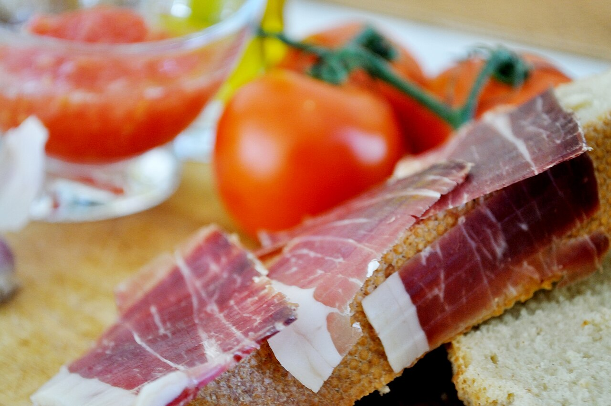

# Toast with olive oil, tomato, garlic and serrano ham

*Photo: [Jose Antonio Galiano](https://commons.wikimedia.org/wiki/File:Jam%C3%B3n_con_tomate_(3220179364).jpg), [CC BY 2.0](https://creativecommons.org/licenses/by/2.0/), via Wikimedia Commons.*

🍅 Serves **4** · ⏱️ 10 minutes · Difficulty: easy

*En español:* [Tostadas de aceite, tomate, ajo y jamón serrano](tostadas-de-aceite-tomate-ajo-jamon-serrano.es.md)

## Ingredients

- 4 large slices of rustic country bread, or 2 small loaves (ciabatta or baguette) split in half
- 2–3 ripe vine or Roma tomatoes (about 10 oz)
- 1 garlic clove
- 5 oz thinly sliced serrano ham (prosciutto works too)
- Extra-virgin olive oil
- Flaky salt or fine salt

## Directions

1. **Grate the tomato.** Rinse the tomatoes, cut them in half, and grate the cut side on the large holes of a box grater over a bowl, until only the skin is left in your hand. Season lightly with salt and stir in a splash of oil.
2. **Toast the bread.** Toast the slices in a toaster, in a dry skillet, or under the broiler until golden and crisp outside but still soft inside.
3. **Rub the garlic.** Peel the garlic clove, cut it in half, and rub it over the hot toast: the rough surface grates it for you. One or two strokes per slice is enough; more if you like it strong.
4. **Oil.** Drizzle each slice generously with olive oil.
5. **Tomato.** Spoon the grated tomato on top and spread it out.
6. **Ham.** Drape the ham slices over the tomato without pressing them down. Serve right away, while the bread is still crisp.

## Tips

- **Ham at room temperature:** take it out of the fridge 15–20 minutes ahead, so it releases its aroma and the fat turns glossy.
- **No grater?** Rub half a tomato straight onto the toast, as in Catalan pa amb tomàquet.
- **Order:** some people add the oil after the tomato. Both work; oil first seals the bread and keeps it crisp.
- **Salt at the end**, and go easy: the ham is already salty.
