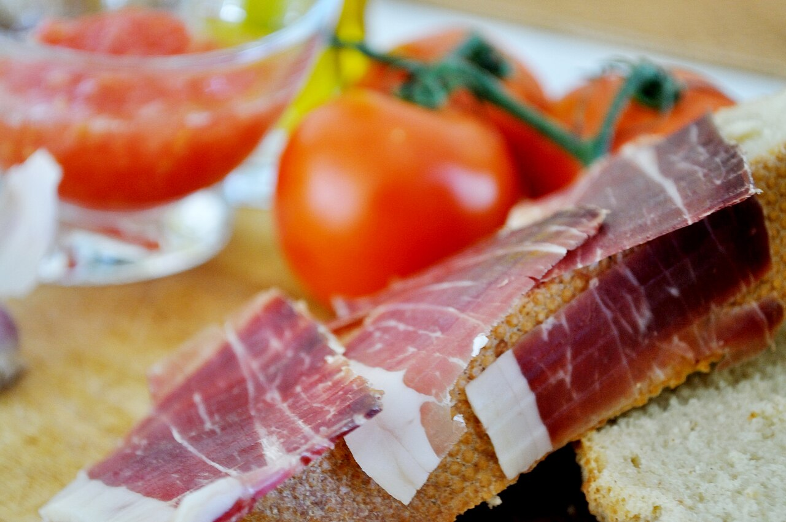

# Tostadas de aceite, tomate, ajo y jamón serrano

*Foto: [Jose Antonio Galiano](https://commons.wikimedia.org/wiki/File:Jam%C3%B3n_con_tomate_(3220179364).jpg), [CC BY 2.0](https://creativecommons.org/licenses/by/2.0/deed.es), vía Wikimedia Commons.*

🍅 Para **4 personas** · ⏱️ 10 minutos · Dificultad: fácil

*In English:* [Toast with olive oil, tomato, garlic and serrano ham](tostadas-de-aceite-tomate-ajo-jamon-serrano.en.md)

## Ingredientes

- 4 rebanadas grandes de pan de pueblo, o 2 barras de pan (mollete, chapata o baguette) abiertas por la mitad
- 2–3 tomates maduros de rama o de pera (unos 300 g)
- 1 diente de ajo
- 150 g de jamón serrano en lonchas finas
- Aceite de oliva virgen extra
- Sal en escamas o sal fina

## Preparación

1. **Rallar el tomate.** Lava los tomates, pártelos por la mitad y rállalos por el lado del corte con un rallador grueso sobre un bol, hasta que solo quede la piel en la mano. Sálalo un poco y añade un chorrito de aceite.
2. **Tostar el pan.** Tuesta las rebanadas en la tostadora, en una sartén sin aceite o bajo el grill del horno, hasta que estén doradas y crujientes por fuera pero tiernas por dentro.
3. **Frotar el ajo.** Pela el diente de ajo, córtalo por la mitad y frótalo sobre el pan aún caliente: la superficie tostada lo ralla sola. Una o dos pasadas por rebanada bastan; más, si te gusta fuerte.
4. **Aceite.** Riega cada tostada con un buen hilo de aceite de oliva.
5. **Tomate.** Reparte el tomate rallado por encima y extiéndelo con una cuchara.
6. **Jamón.** Coloca las lonchas de jamón encima, sin apretarlas. Sirve enseguida, para que el pan siga crujiente.

## Consejos

- **El jamón, a temperatura ambiente:** sácalo de la nevera 15–20 minutos antes; así suelta el aroma y la grasa brilla.
- **Sin rallador:** frota medio tomate directamente sobre el pan, como en el pa amb tomàquet catalán.
- **Orden:** hay quien echa el aceite después del tomate. Las dos formas valen; el aceite primero impermeabiliza el pan y lo mantiene crujiente.
- **Sal al final**, y poca: el jamón ya es salado.
