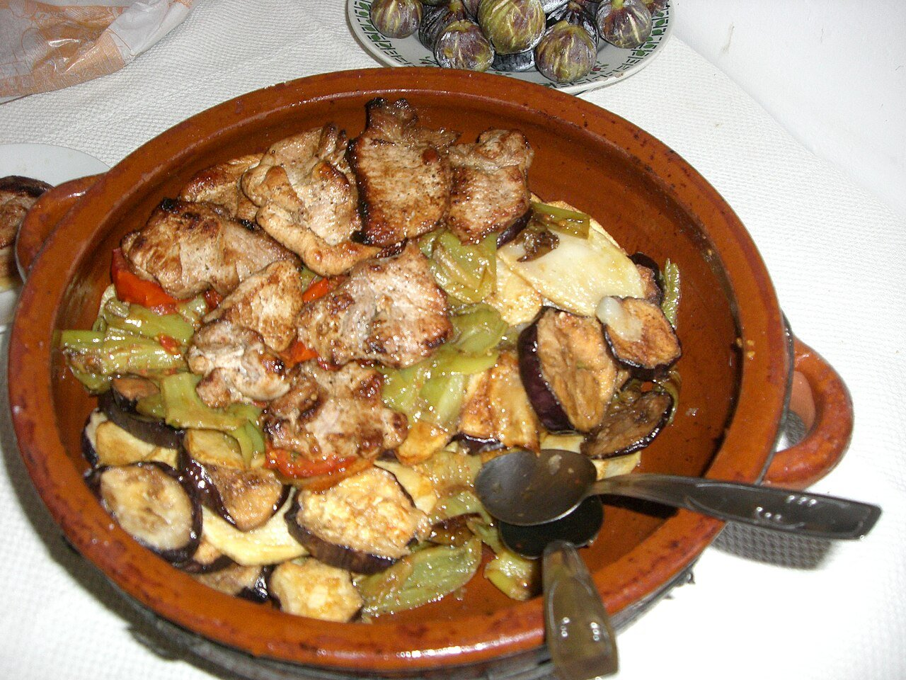

# Mallorcan layered vegetable bake

*Photo: [Paucabot](https://commons.wikimedia.org/wiki/File:Tombet.jpg), [CC BY-SA 3.0](https://creativecommons.org/licenses/by-sa/3.0/), via Wikimedia Commons.*

🍆 Serves **4** · ⏱️ 1 hour 15 minutes · Difficulty: easy

*En español:* [Tumbet mallorquín](tumbet-mallorquin.es.md)

## Ingredients

- 4 medium potatoes
- 2 eggplants
- 3 red bell peppers (or a mix of red and green)
- 2¼ lb ripe tomatoes (or one 28-oz can crushed tomatoes)
- 3 garlic cloves
- 1 teaspoon sugar (optional)
- Olive oil, for frying
- Salt and pepper

## Directions

1. **Tomato sauce.** Sauté the minced garlic in 3 tablespoons of oil, add the peeled, chopped tomatoes, salt and sugar, and simmer 20 minutes. Blend it if you want a smooth sauce.
2. **Potatoes.** Peel the potatoes, slice ¼ inch thick and fry in plenty of oil until tender and lightly golden. Layer them in a baking dish and season with salt.
3. **Eggplant.** Slice the eggplants, salt them and let them sweat 20 minutes. Pat dry, fry and layer over the potatoes.
4. **Peppers.** Cut the peppers into strips, fry until soft and add as a third layer.
5. **Bake.** Cover with the tomato sauce and bake at 350 °F for about 15 minutes.

## Tips

- **Drain well** after frying each vegetable so the dish isn't greasy.
- **Lighter version:** roast the vegetables with a little oil instead of frying.
- **How to serve:** in Mallorca it's eaten on its own or alongside fish or meat.
