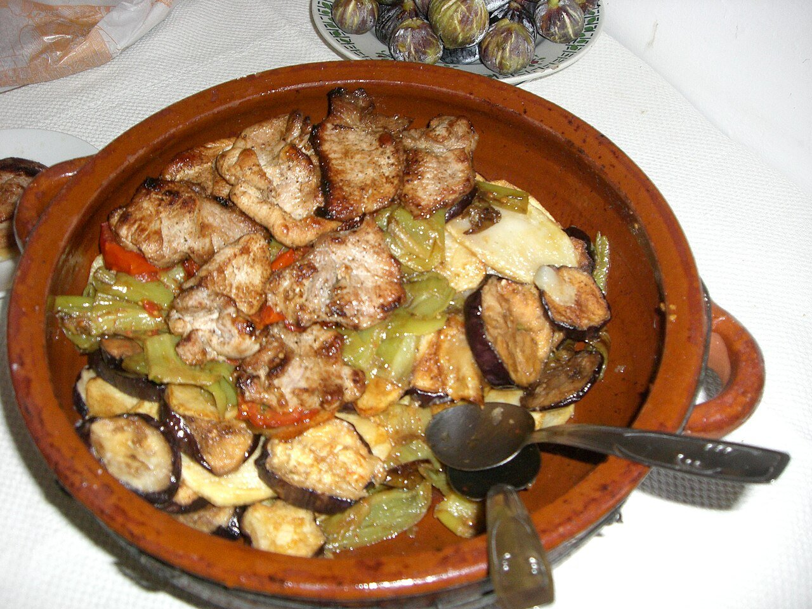

# Tumbet mallorquín

*Foto: [Paucabot](https://commons.wikimedia.org/wiki/File:Tombet.jpg), [CC BY-SA 3.0](https://creativecommons.org/licenses/by-sa/3.0/deed.es), vía Wikimedia Commons.*

🍆 Para **4 personas** · ⏱️ 1 hora 15 minutos · Dificultad: fácil

*In English:* [Mallorcan layered vegetable bake](tumbet-mallorquin.en.md)

## Ingredientes

- 4 patatas medianas
- 2 berenjenas
- 3 pimientos rojos (o verdes y rojos)
- 1 kg de tomates maduros (o 800 g de tomate triturado)
- 3 dientes de ajo
- 1 cucharadita de azúcar (opcional)
- Aceite de oliva, para freír
- Sal y pimienta

## Preparación

1. **Salsa de tomate.** Sofríe el ajo picado en 3 cucharadas de aceite, añade el tomate pelado y troceado, sal y el azúcar, y cuece 20 minutos. Tritúralo si quieres una salsa fina.
2. **Las patatas.** Pela las patatas, córtalas en rodajas de ½ cm y fríelas en abundante aceite hasta que estén tiernas y algo doradas. Colócalas en una fuente de barro y sálalas.
3. **La berenjena.** Corta las berenjenas en rodajas, sálalas y déjalas 20 minutos para que suden. Sécalas, fríelas y colócalas encima de las patatas.
4. **Los pimientos.** Corta los pimientos en tiras, fríelos hasta que estén blandos y ponlos en una tercera capa.
5. **Gratinar.** Cubre con la salsa de tomate y hornea a 180 °C unos 15 minutos.

## Consejos

- **Escurrir bien** cada verdura después de freírla para que no quede grasiento.
- **Más ligero:** hornea las verduras con un poco de aceite en lugar de freírlas.
- **Acompañamiento:** en Mallorca se sirve solo o junto a pescado o carne.
