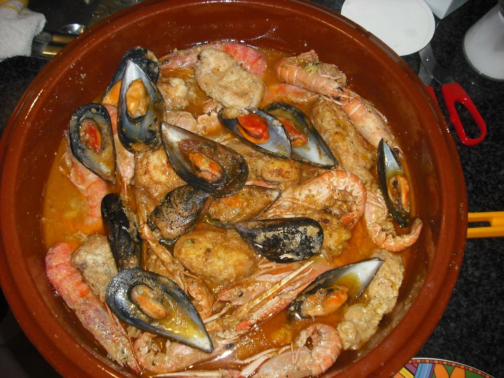

# Catalan seafood stew

*Photo: [TeRe. B](https://commons.wikimedia.org/wiki/File:Sarsuela.jpg), [CC BY-SA 2.0](https://creativecommons.org/licenses/by-sa/2.0/), via Wikimedia Commons.*

🦞 Serves **4** · ⏱️ 1 hour · Difficulty: medium

*En español:* [Zarzuela de mariscos](zarzuela-de-mariscos.es.md)

## Ingredients

- 14 oz monkfish or hake, in chunks
- 10 oz squid or cuttlefish rings
- 8 shrimp or prawns
- 1 lb mussels
- 10 oz clams
- 1 onion
- 1 red bell pepper
- 3 garlic cloves
- 3 ripe tomatoes, grated
- 1 teaspoon sweet smoked paprika
- 3 tablespoons brandy
- ⅔ cup dry white wine
- 2 cups fish stock
- A pinch of saffron threads
- 2 tablespoons toasted almonds and 1 slice fried bread, for the picada
- 6 tablespoons olive oil
- Salt and parsley

## Directions

1. **Prep the shellfish.** Steam the mussels open and remove one shell from each. Soak the clams in salted water 30 minutes to release any sand.
2. **Sear.** In a wide Dutch oven with the oil, sear the shrimp 1 minute per side and the lightly floured fish. Set aside.
3. **Sofrito.** Cook the chopped onion, pepper and garlic 10 minutes. Add the squid for 3 minutes, then the tomato, and cook until reduced. Stir in the paprika.
4. **Flambé and stock.** Pour in the brandy and carefully flambé it (or let it cook off). Add the wine, stock and saffron, and simmer 10 minutes.
5. **Picada.** In a mortar, pound the almonds, fried bread, a garlic clove and parsley with a little stock, and stir it into the pot.
6. **Finish.** Add the fish, clams, mussels and shrimp. Cook 5–6 minutes, until the clams open. Serve sprinkled with parsley.

## Tips

- **Fish goes in last:** it cooks in minutes and shouldn't fall apart.
- **The picada:** the Catalan touch that thickens and flavors the sauce.
- **For dipping:** serve with toast rubbed with garlic.
