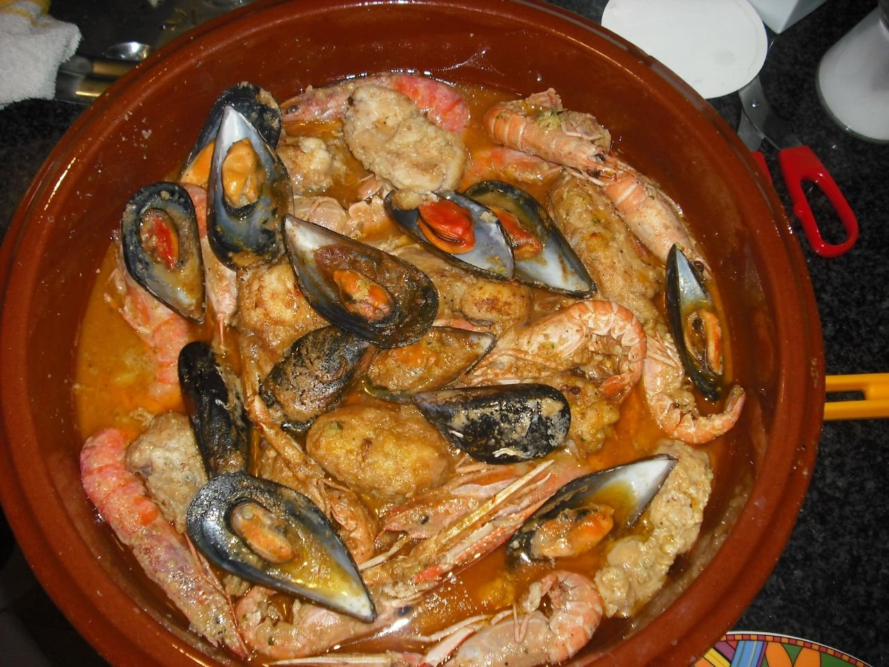

# Zarzuela de mariscos

*Foto: [TeRe. B](https://commons.wikimedia.org/wiki/File:Sarsuela.jpg), [CC BY-SA 2.0](https://creativecommons.org/licenses/by-sa/2.0/deed.es), vía Wikimedia Commons.*

🦞 Para **4 personas** · ⏱️ 1 hora · Dificultad: media

*In English:* [Catalan seafood stew](zarzuela-de-mariscos.en.md)

## Ingredientes

- 400 g de rape o merluza en trozos
- 300 g de calamar o sepia en anillas
- 8 gambas o langostinos
- 500 g de mejillones
- 300 g de almejas
- 1 cebolla
- 1 pimiento rojo
- 3 dientes de ajo
- 3 tomates maduros rallados
- 1 cucharadita de pimentón dulce
- 50 ml de brandy
- 150 ml de vino blanco
- 500 ml de caldo de pescado
- Unas hebras de azafrán
- 20 g de almendras tostadas y 1 rebanada de pan frito, para la picada
- 6 cucharadas de aceite de oliva
- Sal y perejil

## Preparación

1. **Preparar el marisco.** Abre los mejillones al vapor y retira una concha. Deja las almejas en agua con sal 30 minutos para que suelten la arena.
2. **Marcar.** En una cazuela ancha con el aceite, dora las gambas 1 minuto por lado y el pescado enharinado ligeramente. Reserva.
3. **Sofrito.** Pocha la cebolla, el pimiento y el ajo picados 10 minutos. Añade el calamar 3 minutos, luego el tomate, y cocina hasta que se reduzca. Añade el pimentón.
4. **Flambear y caldo.** Vierte el brandy y flambéalo con cuidado (o deja que se evapore). Añade el vino, el caldo y el azafrán, y cuece 10 minutos.
5. **La picada.** Machaca en un mortero las almendras, el pan frito, un ajo y perejil con un poco de caldo, y añádelo a la cazuela.
6. **Terminar.** Incorpora el pescado, las almejas, los mejillones y las gambas. Cuece 5–6 minutos, hasta que las almejas se abran. Sirve con perejil picado.

## Consejos

- **El pescado, al final:** se hace en pocos minutos y no debe deshacerse.
- **La picada:** es el toque catalán que espesa y da sabor a la salsa.
- **Para mojar:** sirve con pan tostado frotado con ajo.
